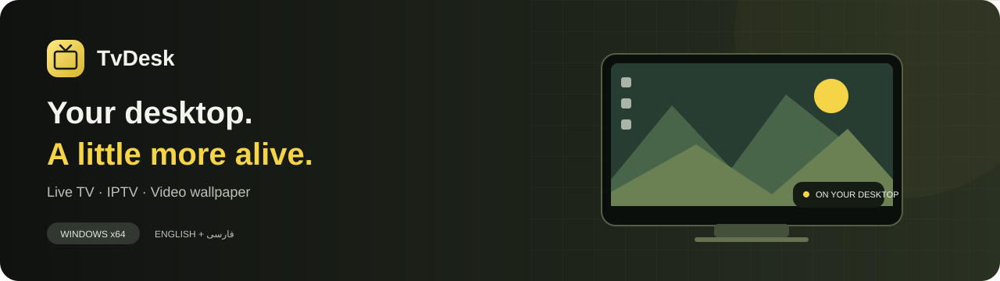
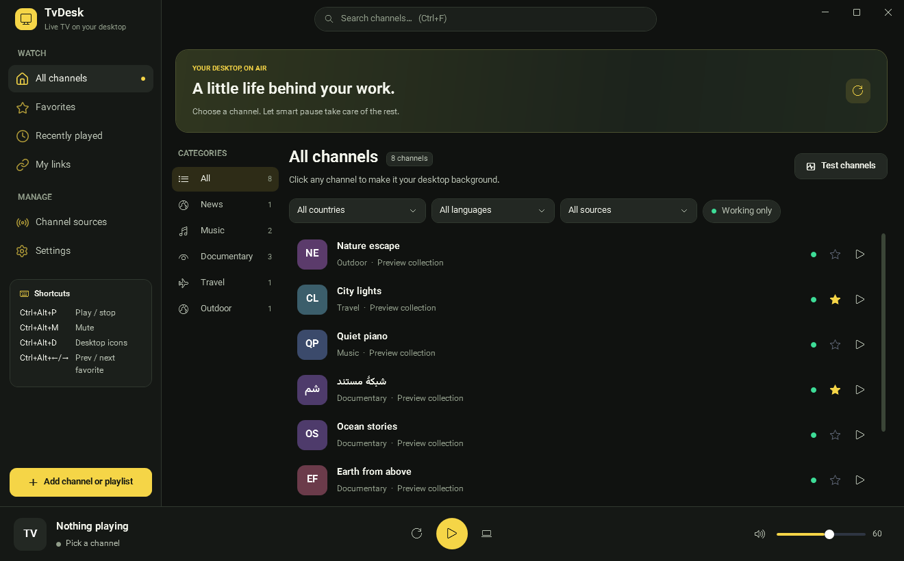
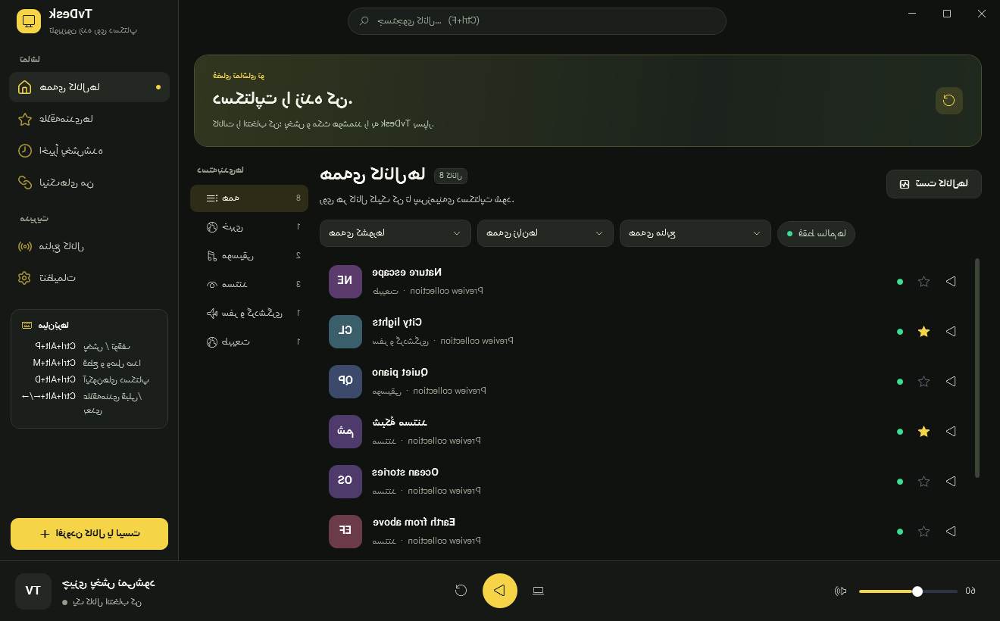

<p align="center"></p>

<p align="center">
  <a href="https://github.com/maboox/TvDesk/releases/latest"></a>
  <a href="docs/README.fa.md"></a>
  <a href="https://github.com/maboox/TvDesk/issues/new/choose"></a>
</p>
<p align="center">
  <a href="https://github.com/maboox/TvDesk/actions/workflows/ci.yml"></a>
  <a href="LICENSE"></a>
  
  
</p>

# Live streams, behind your desktop icons

Turn a live channel, IPTV link, YouTube video or local video into your Windows wallpaper. TvDesk keeps playback controls in one calm workspace, with favorites, source filters and smart pause when you need the resources elsewhere.

**[Download the latest release](https://github.com/maboox/TvDesk/releases/latest)** · **[راهنمای کامل فارسی](docs/README.fa.md)** · [Build it yourself](docs/BUILDING.md) · [Privacy](PRIVACY.md)

> فارسی: تلویزیون زنده، IPTV و ویدیو را پشت آیکون‌های دسکتاپ ویندوز تماشا کنید؛ با رابط فارسی و انگلیسی، علاقه‌مندی‌ها و مکث هوشمند.


<sub>Actual WPF interface rendered with synthetic preview channels; these are layout examples, not a promise of channel availability.</sub>

## A wallpaper player that fits your day

| Watch your way | Stay in control |
|---|---|
| Public channel catalogs, or your own authorized IPTV source | Categories, country, language and source filters |
| YouTube and supported web-video pages through yt-dlp | Favorites, recent playback and Persian-aware search |
| M3U playlist URLs, local playlists and local videos | Loop local files, set volume/quality and choose a monitor |
| Wallpaper behind desktop icons, with tray controls | Pause or mute for fullscreen apps, battery power and lock |
| Separate, replaceable VLC libraries | Reconnect with backoff and test channel availability |
| Yellow/graphite theme and Lucide vector navigation | Persian RTL, English LTR and visible keyboard focus |

Public streams can be offline, region-restricted or change without notice. TvDesk is a player; it does not host, sell or grant access rights to any channel. Only play content you are allowed to access.

## Get started

1. Download **TvDesk-win-x64.zip** from [Releases](https://github.com/maboox/TvDesk/releases/latest). Windows 10/11 **x64** is required.
2. Extract the entire folder, then run `TvDesk.exe`. Keep `libvlc`, `yt-dlp.exe` and the accompanying files together. The release includes the .NET runtime; no separate installation or administrator access is needed.
3. Choose Persian or English and enable the sources you want. Pick a channel, or use **Add channel or playlist** for your own link or video.
4. Tune **Settings → Smart pause** and your display target. Closing the main window keeps playback in the tray; use the tray's **Exit** command to fully quit.

Release executables are unsigned. Compare the ZIP's SHA-256 with the accompanying `.sha256` file if you want to check download consistency. A checksum does not establish publisher identity.

<details>
<summary><strong>Persian interface preview / پیش‌نمایش فارسی</strong></summary>



</details>

## Shortcuts

| Shortcut | Action |
|---|---|
| `Ctrl+F` | Open the channel workspace and focus search |
| `Enter` / `F` on a selected channel | Play / toggle favorite |
| `Ctrl+Alt+P` | Play / stop |
| `Ctrl+Alt+M` | Mute / unmute |
| `Ctrl+Alt+D` | Hide / show desktop icons |
| `Ctrl+Alt+←` / `→` | Previous / next favorite |
| `Ctrl+Alt+T` | Show TvDesk |

Global shortcuts may conflict with other applications. You can always use the window or tray controls.

## Privacy and security, made explicit

- No TvDesk account, telemetry or hosted backend. Media, playlist and logo providers still receive network requests and your IP address.
- Settings and playlist caches use Windows current-user protection. URLs and local paths are redacted in logs; the health cache stores hashed identifiers.
- Remote playlists cannot directly select local/SMB paths or arbitrary VLC input modules. Downloads have size limits; an invalid custom proxy blocks downloads.
- The bundled helper is pinned and SHA-256 verified, with plugins and user configuration disabled. It does not read your browser cookies or self-update in the background.
- Locked NuGet packages, dependency advisory checks and CI accompany the source. These checks do not make every external stream, codec or website safe.

Read [the privacy policy](PRIVACY.md) and [security policy](SECURITY.md) for data locations, trust boundaries, migration details and private reporting.

## Build and contribute

```powershell
dotnet restore tests/TvDesk.Tests.csproj --locked-mode
dotnet build tests/TvDesk.Tests.csproj -c Release --no-restore
dotnet run --project tests/TvDesk.Tests.csproj -c Release --no-build
./scripts/Publish.ps1
```

Requires Windows and a **.NET 10 SDK**. [Building, testing and packaging](docs/BUILDING.md) covers native playback checks, bilingual UI rendering and release steps. See [CONTRIBUTING.md](CONTRIBUTING.md) and [CHANGELOG.md](CHANGELOG.md).

## Troubleshooting

- **Wallpaper missing:** use **Settings → Re-attach to desktop**. Try a different video output and test a local video first. Explorer attachment depends on the Windows build and graphics driver.
- **A web video fails:** test the provider in a browser, then **Install / repair** the verified helper. New extractor versions ship with TvDesk updates; availability and provider restrictions can change.
- **A channel fails:** check regional availability and your proxy. Refresh sources or test the visible list. Channel tests contact the providers and may consume bandwidth.
- **Settings reset after moving accounts:** protected data belongs to the original Windows account. Re-add your sources under the new account.

Review logs before sharing them, especially files created by older releases. Never attach settings, private playlists or provider credentials to an issue.

## Credits and licensing

TvDesk source is [MIT](LICENSE). [VLC / LibVLCSharp](https://www.videolan.org/), [yt-dlp](https://github.com/yt-dlp/yt-dlp), [Vazirmatn](https://github.com/rastikerdar/vazirmatn) and [Lucide](https://lucide.dev/) retain their own licenses. See [third-party notices](THIRD-PARTY-NOTICES.md) and the bundled license files. Public catalogs reference [iptv-org](https://github.com/iptv-org/iptv) and [Free-TV](https://github.com/Free-TV/IPTV).
